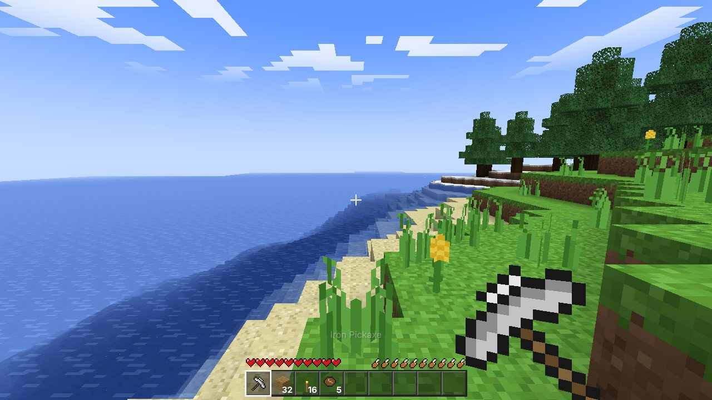
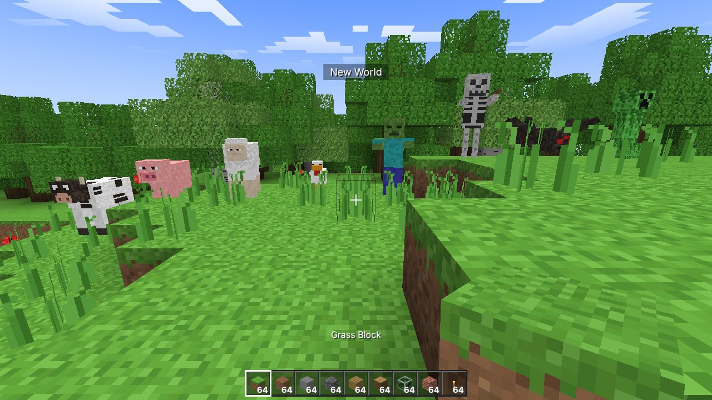
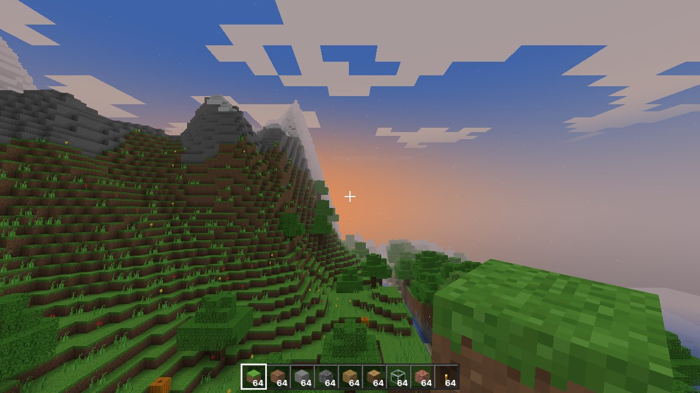
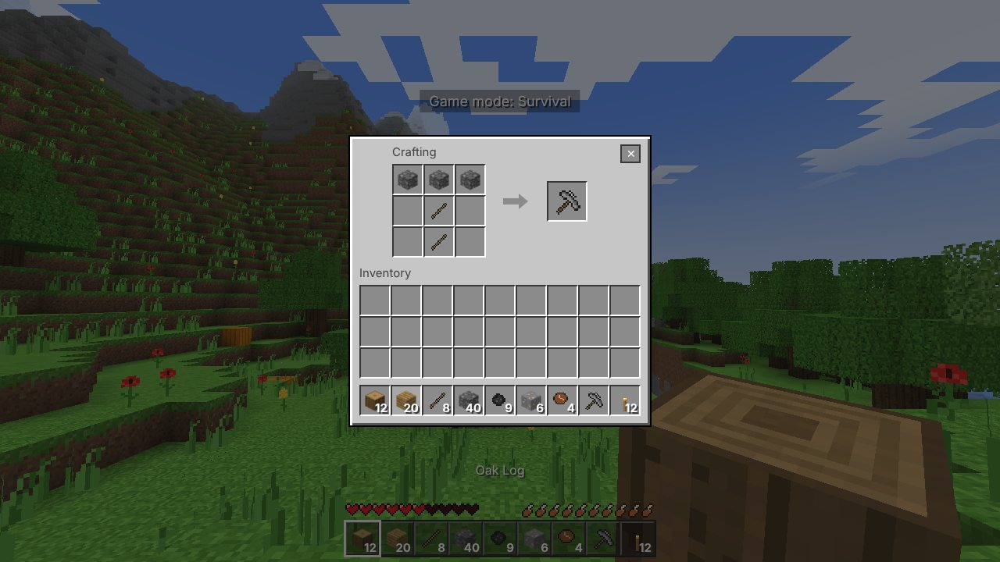

# VoxelCraft

A Minecraft-style 3D voxel sandbox game that runs entirely in the browser — explore an
infinite procedurally generated world, mine, craft, build, and survive the night.
Built with HTML5, CSS3, JavaScript (ES modules), Three.js and WebGL2. No backend, no build
step and no external downloads: every texture, icon and sound is generated procedurally at
startup, and Three.js is vendored in `lib/`.



| | |
| --- | --- |
|  |  |
|  | |

## Running locally

Browsers block ES modules and Web Workers on `file://` URLs, so serve the folder over HTTP.
Pick any one of these from inside the `voxelcraft/` directory:

```bash
node server.js            # zero-dependency server bundled with the game (Node 16+)
npm start                 # same thing
python3 -m http.server 8080
```

Then open <http://localhost:8080>. On a phone or tablet on the same network, open
`http://<your-computer-ip>:8080` (landscape orientation recommended).

**Browser requirements:** WebGL2, ES modules and module workers — any current Chrome, Edge,
Firefox (114+), Safari (15+) or their mobile versions.

Run the headless test suite (terrain, meshing, crafting, inventory, storage, physics and
player survival logic) with:

```bash
npm test                  # or: node tests/run.mjs
```

## Controls

| Desktop | Action |
| --- | --- |
| `W` `A` `S` `D` | Move |
| Mouse | Look around (click the game to capture the mouse) |
| `Space` | Jump / swim up — double-tap to toggle flying in Creative |
| `Shift` (or double-tap `W`) | Sprint |
| `Ctrl` or `C` | Crouch (stops you walking off edges) / fly down |
| Left click (hold) | Break block / attack |
| Right click | Place block / use crafting table or furnace / eat (hold) |
| Middle click | Pick block |
| `E` | Inventory & crafting |
| `1`–`9`, mouse wheel | Select hotbar slot |
| `Q` / `Ctrl`+`Q` | Drop one item / the whole stack |
| `F3` | Debug overlay (FPS, position, biome, chunk stats) |
| `Esc` | Pause menu |

> Browsers reserve some `Ctrl` shortcuts (for example `Ctrl`+`W` closes the tab), so `C` is
> provided as an alternative crouch key.

| Touch | Action |
| --- | --- |
| Left joystick | Move (push to the top edge to sprint) |
| Drag on the right side | Look around |
| Tap the world | Place block / use / attack the creature under the crosshair |
| Hold on the world | Break block |
| Buttons | Jump, break, place, sneak (toggle), inventory, drop, pause, fly (Creative) |
| Tap a hotbar slot | Select it |

Inventory: click to pick up / put down, right-click to split a stack or place one item,
shift-click (or double-click / double-tap) to quick-move, or drag a stack onto another slot.
Click outside the panel to throw the held stack.

## Features

**World generation** — seeded simplex-noise terrain in 16×16×128 chunks: continents and
oceans, rolling hills, ridged snow-capped mountains, winding rivers and lakes, beaches,
plains, oak and birch forests, spruce taiga, snowy tundra and cactus deserts. Spaghetti
tunnels and large caverns run underground, with coal, iron, gold and diamond ore veins at
realistic depths, plus clay, gravel and dirt pockets. Trees and plants are placed
deterministically so they line up across chunk borders.

**Survival** — 10 hearts and 10 hunger shanks with saturation and exhaustion, natural
regeneration, starvation, fall damage, drowning (air bubbles), cactus damage, death with item
drops and respawn. Different blocks take different times to break depending on the tool, and
ores need the right pickaxe tier to drop anything. Tools wear out.

**Creative** — unlimited blocks from a creative inventory, instant breaking and free flight.
Switch modes when creating a world, or at any time from the pause menu.

**Crafting** — 2×2 grid in the inventory and 3×3 on a crafting table, with shaped
(mirrorable) and shapeless recipes: planks, sticks, crafting table, furnace, torches,
wooden/stone/iron/diamond pickaxes, axes, shovels and swords, sandstone, stone bricks,
bricks, wool, bookshelves, mineral blocks, arrows and more. Furnaces smelt ores into ingots,
sand into glass, cobblestone into stone, logs into charcoal and cook raw meat, using coal or
wood as fuel; they keep working while you're away and glow while lit.

**Creatures** — cows, pigs, sheep and chickens wander, avoid cliffs and flee when hit, and
drop food, leather, wool and feathers. At night (and in dark caves) zombies and spiders chase
and attack, skeletons keep their distance and shoot arrows, and creepers sneak up, swell, flash
and explode, destroying terrain. Zombies and skeletons burn in sunlight. Creatures jump up
steps, steer around obstacles (spiders climb walls) and are animated (walking legs, swinging
arms, flapping wings, head tracking, hurt flashes, death fall).

**Blocks & physics** — gravity-affected sand and gravel, torches that attach to walls,
plants and torches that pop off when their support is removed, a simple water-spreading
simulation when you dig next to water, and swimming.

**Graphics** — 16×16 pixel-art textures generated procedurally, smooth flood-fill sky and
torch lighting with ambient occlusion, a day/night cycle with a gradient sky, sunsets, sun,
moon, stars and drifting blocky clouds, directional sun shading, distance and underwater
fog, translucent animated water, block-breaking particles, crack overlays, and a
first-person hand that swings and bobs.

**Interface** — main menu, world selection (play/delete), world creation (name, seed,
game mode), settings (render distance, FOV, sensitivity, volume, brightness, day length,
resolution, clouds, view bobbing, auto-jump, invert mouse, FPS counter, mob spawning, touch
controls), how-to-play screen, pause menu, death screen, HUD with hotbar, hearts, hunger,
air bubbles and item names, plus inventory, crafting table, furnace and creative screens.

**Saving** — worlds are stored in IndexedDB: seed, game mode, time of day, player position,
look direction, health, hunger, inventory, furnace contents and every modified chunk
(RLE-compressed). The game autosaves every 30 seconds, when paused, when the tab is hidden
and when quitting, so you can close the browser and continue later.

## Project structure

```
voxelcraft/
├── index.html            Entry point (HUD, menus and touch controls markup)
├── css/style.css         All styling (responsive for landscape and portrait)
├── server.js             Zero-dependency static file server
├── lib/                  Three.js r170 (vendored, MIT licence)
├── tests/run.mjs         Headless unit tests (Node)
├── docs/                 Screenshots
└── js/
    ├── main.js           Game class: state machine, main loop, saving, explosions
    ├── settings.js       Persistent settings + settings screen schema
    ├── engine/
    │   ├── constants.js  Chunk dimensions, sea level
    │   ├── noise.js      Seeded simplex noise, hashing, PRNG
    │   ├── blocks.js     Block registry (shapes, textures, hardness, tools, drops, light)
    │   ├── terrain.js    Biomes, heightmap, rivers, caves, ores, trees, plants
    │   ├── mesher.js     Lighting + AO + hidden-face removal + greedy meshing
    │   ├── worker.js     Web Worker entry (terrain generation and meshing)
    │   ├── world.js      Chunk loading/unloading, worker pool, block access, raycasts
    │   ├── storage.js    IndexedDB persistence and chunk compression
    │   ├── textures.js   Procedural pixel textures → WebGL2 texture array
    │   └── material.js   Chunk shaders (lighting, fog, water)
    ├── game/
    │   ├── player.js     First-person controller, physics, survival stats
    │   ├── physics.js    Swept AABB voxel collision
    │   ├── interaction.js Mining, placing, attacking, eating, block updates
    │   ├── entities.js   Creature AI/spawning, dropped items, falling blocks, arrows
    │   ├── models.js     Blocky creature models and procedural skins
    │   ├── items.js      Items, tools, food + procedural item/HUD icons
    │   ├── inventory.js  36-slot inventory
    │   ├── crafting.js   Recipes, smelting and fuel tables
    │   ├── furnace.js    Furnace block entities
    │   ├── sky.js        Day/night sky, sun, moon, stars, clouds, lights
    │   ├── hand.js       First-person held item
    │   ├── particles.js  Pooled instanced particles
    │   ├── audio.js      Synthesised sound effects (Web Audio)
    │   └── input.js      Keyboard, mouse and pointer lock
    └── ui/
        ├── screens.js    Menus, world list, settings, pause, death, loading
        ├── hud.js        Hotbar, hearts, hunger, bubbles, debug overlay
        ├── inventoryUI.js Inventory / crafting / furnace / creative screens
        └── touch.js      Virtual joystick and touch buttons
```

## How it works

* **Chunk pipeline.** The world is a map of 16×16×128 chunks. Each frame, idle workers pick
  the most valuable job nearest the player: urgent remeshes after edits first, then generation
  or meshing in a distance-sorted spiral. Chunks beyond the render distance are unloaded
  (saving them first if modified).
* **Meshing.** A worker copies the chunk plus a 14-block margin from its neighbours, floods
  sky light and torch light through the volume, and emits only faces adjacent to non-opaque
  blocks. Faces with identical texture, light and AO are merged with greedy meshing; per-vertex
  smooth light and ambient occlusion are baked into a compact vertex attribute. Each 16-block
  tall section is a separate mesh so Three.js can frustum-cull it.
* **Textures.** All block tiles live in a single WebGL2 texture array, so merged quads can
  repeat their texture without atlas bleeding while mipmapping still works.
* **Edits.** Changing a block remeshes its chunk (and touching neighbours) immediately with
  high priority; neighbours whose lighting may change are refreshed lazily a moment later.
* **Physics.** The player and every entity use the same swept AABB collision against the
  voxel grid, resolving the Y axis first, then X and Z.

## Limitations

Single-player only. Water is a simplified non-levelled simulation, there is no redstone,
farming or beds, and leaves don't decay. Creatures are not saved with the world — they
respawn naturally.
